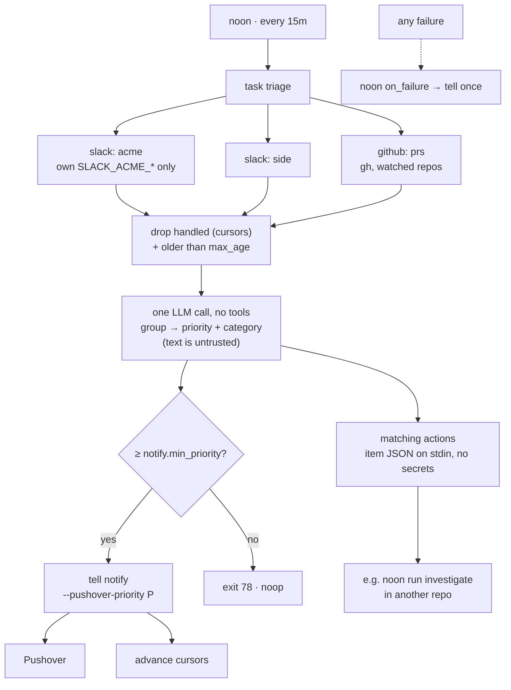

# watch

A [Noon](https://github.com/brettinternet/noon) job collects signals from each configured source — unread Slack messages through [slack-mcp-server](https://github.com/korotovsky/slack-mcp-server), recently merged GitHub PRs through `gh` — then Claude or Pi groups and prioritizes them, [Tell](https://github.com/brettinternet/tell) sends one Pushover notification at the matching priority, and optional actions run for matching items, such as starting an agent to investigate an incident.



## Setup

Each clone is configured separately:

1. Run `task init` to install tools and dependencies, create `.env.local` and `triage.local.yaml`, and install hooks.
2. Add each Slack workspace's tokens. From the signed-in macOS desktop app, `task setup:slack -- acme` extracts the stealth `xoxc`/`xoxd` tokens into `.env.local` (`acme` sets the `SLACK_ACME_` prefix; pass `--workspace <name>` when several workspaces are signed in). It may ask once for Keychain access. See [token automation](#token-automation) for how it works. Then add your Pushover credentials:

    ```dotenv
    PUSHOVER_TOKEN=...
    PUSHOVER_USER=...
    ```

    Any `SLACK_ACME_*` key reaches only that workspace's server, remapped to `SLACK_MCP_*`.

3. Edit `triage.local.yaml` (scaffolded from [`triage.example.yaml`](triage.example.yaml)) to list your sources:

    ```yaml
    llm:
        agent: pi # default: claude
        args: [--model, sonnet]
    sources:
        acme: { kind: slack }
        side: { kind: slack, channel_types: dm, mentions_only: true }
        prs: { kind: github, repos: [acme/api, acme/web] }
    ```

4. Run `task setup:tell` to route this clone's notifications to Pushover in `.git/tell.yaml`.
5. Run `task triage -- --dry-run` to preview a run without notifying, running actions, or recording anything. The first run against a large workspace is slow while the user and channel caches sync.
6. Run `noon enable` to schedule triage and the hourly `update` job, which fast-forwards this checkout, installs dependencies, and notifies when `noon.yaml` changed and needs `noon enable` again. Both jobs notify once when they start failing. The Noon service's `PATH` must include `mise`, the agent CLI, and `gh`.

## Sources

Each source has a name (the key) and a `kind`. The name labels its signals and, for Slack, is the `SLACK_<NAME>_` env prefix, so keep it to lowercase letters and digits.

| Kind     | Fields                                                                                                                                                                                                                        | Produces                                         |
| -------- | ----------------------------------------------------------------------------------------------------------------------------------------------------------------------------------------------------------------------------- | ------------------------------------------------ |
| `slack`  | `url` (workspace URL, enables message links), `channel_types` (`all`/`dm`/`group_dm`/`partner`/`internal`), `mentions_only`, `thread_mentions` (default true), `max_channels`, `max_messages_per_channel`, `exclude_channels` | unread messages, thread replies that mention you |
| `github` | `repos: [owner/repo, …]`, `author` (default `@me`)                                                                                                                                                                            | PRs merged within `max_age`, via `gh`            |

## Token automation

`task setup:slack -- <name>` reads this machine's signed-in Slack session the way the slack-mcp-server docs describe doing by hand, and writes `SLACK_<NAME>_XOXC_TOKEN` and `SLACK_<NAME>_XOXD_TOKEN` to `.env.local`:

- `xoxc` comes from the desktop app's Local Storage (`~/Library/Application Support/Slack`), matched to a workspace by the team name next to it.
- `xoxd` is the `d` cookie, decrypted with the `Slack Safe Storage` Keychain key (AES-128-CBC, the standard macOS Chromium scheme).

It is a best-effort devtool for macOS and may need updating when Slack changes its storage. Stealth tokens expire; re-run the command when they do. If a run fails with `invalid_auth` in the log, the collector says to re-run it. For a browser session instead of the app, pass `--app-dir` at the Chromium profile, or copy the tokens by hand from the browser ([how](https://github.com/korotovsky/slack-mcp-server/blob/master/docs/01-authentication-setup.md)). To avoid session tokens entirely, set a long-lived `SLACK_<NAME>_XOXP_TOKEN` (User OAuth) instead; `serverEnv` accepts it in place of the `xoxc`/`xoxd` pair.

## Per-clone files

All of these are gitignored or live in `.git`.

| File                | Purpose                                                                                                                                                |
| ------------------- | ------------------------------------------------------------------------------------------------------------------------------------------------------ |
| `.env.local`        | Secrets                                                                                                                                                |
| `triage.local.yaml` | Sources, LLM, and actions. Scaffolded from [`triage.example.yaml`](triage.example.yaml); deep-merges over [`triage.yaml`](triage.yaml), lists replace. |
| `triage.local.md`   | Extra instructions appended to [`prompts/triage.md`](prompts/triage.md), e.g. who you are and what you own                                             |
| `.noon.vars`        | `TRIAGE_SCHEDULE` (default `*/15 * * * *`), `TRIAGE_TIMEOUT` (default `10m`), and `UPDATE_SCHEDULE` (default `0 * * * *`)                              |
| `.git/tell.yaml`    | Notification routing                                                                                                                                   |
| `.git/noon.yaml`    | Private Noon jobs                                                                                                                                      |

## How a run works

1. Collect unread messages from every source, plus Slack thread replies that mention you, which the unread scan misses. Messages stay unread in Slack.
2. Drop messages already handled, using per-channel cursors in `.state/cursors.json`, and messages older than `max_age`.
3. One LLM call with no tools groups messages into items with a priority and category. If it flags up to three items at or above `notify.min_priority` as needing context, the collector fetches their Slack threads and recent channel messages read-only, and a second call triages again with them. The overall priority is the highest item's priority.
4. If it reaches `notify.min_priority`, run `tell notify` with `notify.args[priority]`. Emergency priority repeats every `retry` until acknowledged or `expire`.
5. Run matching actions, then advance the cursors.

A run exits 0 after notifying, 78 (a Noon noop) when nothing reached the threshold, and 1 on any failure. A failed notification leaves its messages for the next run. If the LLM fails, a fallback lists counts per channel, with DMs at normal priority. A failed context fetch keeps the first pass. Either way the run still exits 1, and Noon's `on_failure` hook notifies once when a streak of failures starts.

## Actions

```yaml
# triage.local.yaml
actions:
    investigate:
        when: { categories: [incident], min_priority: high }
        run: noon -C ~/dev/service run investigate --detach --key "$TRIAGE_KEY" --data -
```

An action runs from this repository with the item as JSON on stdin (`action`, `key`, `priority`, `category`, `reason`, `signals`). Its environment has `TRIAGE_ACTION`, `TRIAGE_KEY`, `TRIAGE_PRIORITY`, and `TRIAGE_CATEGORY`, plus `PATH`, `HOME`, and locale variables, and no secrets. `TRIAGE_KEY` is stable per item, so Noon's `--key` drops duplicates.

The receiving job reads the item from `$NOON_EVENT_FILE`:

```yaml
# ~/dev/service/.git/noon.yaml
jobs:
    investigate:
        requests: each
        prompt: |
            Read the triage item in the JSON file at $NOON_EVENT_FILE. Investigate it in this
            repository, then report the likely cause and a recommended fix. Change nothing.
```

Message text is untrusted input. Give that agent read-only tools.

## Agent sessions

`.mcp.json` (and `.pi/mcp.json`, a symlink to it) adds a `slack-local` MCP server through `task slack:mcp` (named so it never shadows an official `slack` server), using the first Slack source's tokens from the primary checkout, so it also works in worktrees. Pass `-- <source>` for another workspace. Tools are read-only; set `SLACK_<NAME>_ENABLED_TOOLS` in `.env.local` to a tool list, or `all` for every tool including posting.

## Development

`task test`, `task typecheck`, and `task triage -- --dry-run`. `task doctor` checks setup, credentials (including a live Slack `auth.test`), and Noon and Tell readiness without side effects. To add a source kind, add its schema to `src/config.ts`, a collector in `src/sources/` returning `Signal[]`, and a case in `collect()` in `src/main.ts`.
