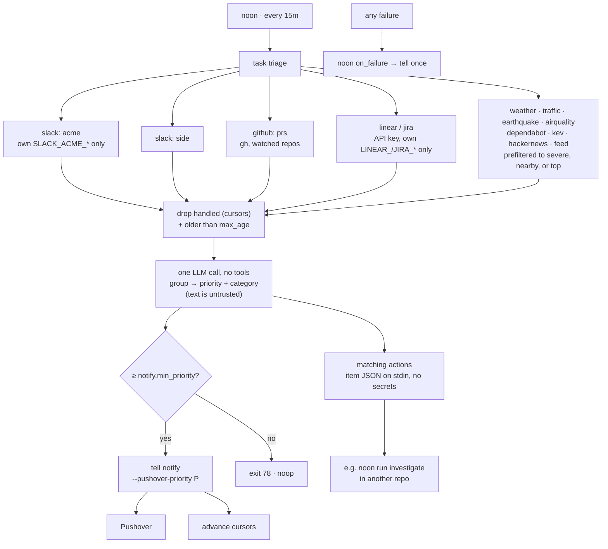

# watch

A [Noon](https://github.com/brettinternet/noon) job collects signals from each configured source — unread Slack messages through [slack-mcp-server](https://github.com/korotovsky/slack-mcp-server), recently merged or ready-to-merge GitHub PRs through `gh`, Linear and Jira asks from teammates, severe weather and traffic near you, and top news — then Claude or Pi groups and prioritizes them, [Tell](https://github.com/brettinternet/tell) sends one Pushover notification at the matching priority, and optional actions run for matching items, such as starting an agent to investigate an incident.



## Setup

Each clone is configured separately:

1. Run `task init` to install tools and dependencies, create `.env.local` and `triage.local.yaml`, and install hooks.
2. Add each Slack workspace's tokens. From the signed-in macOS desktop app, `task setup:slack -- acme` extracts the stealth `xoxc`/`xoxd` tokens into `.env.local` (`acme` sets the `SLACK_ACME_` prefix and picks the signed-in workspace whose team name or URL contains it; pass `--workspace <name>` when it doesn't match). It may ask once for Keychain access. See [token automation](#token-automation) for how it works. Then add your Pushover credentials:

    ```dotenv
    PUSHOVER_TOKEN=...
    PUSHOVER_USER=...
    ```

    For a `linear` or `jira` source, add its API credentials under the same per-source prefix: `LINEAR_<NAME>_API_KEY` (a [personal API key](https://linear.app/settings/account/security)), or `JIRA_<NAME>_EMAIL` and `JIRA_<NAME>_API_TOKEN` (an [Atlassian API token](https://id.atlassian.com/manage-profile/security/api-tokens)).

    Any `SLACK_ACME_*` key reaches only that workspace's server, remapped to `SLACK_MCP_*`.

3. Edit `triage.local.yaml` (scaffolded from [`triage.example.yaml`](triage.example.yaml)) to list your sources:

    ```yaml
    llm:
        agent: pi # default: claude
        args: [--model, sonnet]
    sources:
        slack:
            acme: {}
            side: { channel_types: dm, mentions_only: true }
        github:
            acme: { repos: [acme/api, acme/web] }
        linear:
            acme: {}
        jira:
            acme: { url: https://acme.atlassian.net }
    ```

4. Run `task setup:tell` to route this clone's notifications to Pushover in `.git/tell.yaml`.
5. Run `task triage -- --dry-run` to preview a run without notifying, running actions, or recording anything. The first run against a large workspace is slow while the user and channel caches sync.
6. Run `noon enable` to schedule triage, the weekday [`agenda`](#daily-agenda), and the hourly `update` job, which fast-forwards this checkout, installs dependencies, and notifies when `noon.yaml` changed and needs `noon enable` again. Both jobs notify once when they start failing. The Noon service's `PATH` must include `mise`, the agent CLI, and `gh`.

## Sources

Sources are grouped by kind, then keyed by a name such as the workspace's. The name sets the source's env prefix (`SLACK_<NAME>_`, `LINEAR_<NAME>_`, `JIRA_<NAME>_`), so keep it to lowercase letters and digits. Names are unique per kind, and elsewhere a source is `kind/name`, e.g. `slack/acme` in `actions.<name>.when.sources`.

| Kind         | Fields                                                                                                                                                                                                                                             | Produces                                                                                                                            |
| ------------ | -------------------------------------------------------------------------------------------------------------------------------------------------------------------------------------------------------------------------------------------------- | ----------------------------------------------------------------------------------------------------------------------------------- |
| `slack`      | `url` (workspace URL, enables message links), `channel_types` (`all`/`dm`/`group_dm`/`partner`/`internal`), `mentions_only`, `thread_mentions` (default true), `max_channels`, `max_messages_per_channel`, `exclude_channels`, `priority_channels` | unread messages, thread replies that mention you or are in your threads                                                             |
| `github`     | `repos: [owner/repo, …]`, `author` (default `@me`), `events` (`merged`, `ready`, `review`; default `[merged]`)                                                                                                                                     | PRs merged within `max_age`, open PRs whose required checks and reviews all pass, and PRs requesting your review directly, via `gh` |
| `linear`     | none                                                                                                                                                                                                                                               | unread inbox assignments, mentions, and comments                                                                                    |
| `jira`       | `url` (Jira Cloud site)                                                                                                                                                                                                                            | comments and assignments on issues you follow                                                                                       |
| `weather`    | `lat`, `lon`                                                                                                                                                                                                                                       | NWS warnings at that point that are severe or extreme, observed or likely, and happening now or expected (US only)                  |
| `traffic`    | `url` (a 511 site with the IBI developer API), `areas: [{ lat, lon, km }]` (`km` default 10)                                                                                                                                                       | crashes, incidents, and closures that have started, block every lane or are rated Major, and touch an area; no roadwork             |
| `earthquake` | `lat`, `lon`, `km` (default 150), `min_magnitude` (default 4)                                                                                                                                                                                      | USGS earthquakes within `km`                                                                                                        |
| `airquality` | `lat`, `lon`                                                                                                                                                                                                                                       | each local day, today or tomorrow, whose Open-Meteo US AQI forecast reaches unhealthy (151), once                                   |
| `dependabot` | `owners: [login, …]` (users or orgs)                                                                                                                                                                                                               | new critical and high Dependabot alerts on their active, non-fork repos, via `gh`                                                   |
| `kev`        | `match: [text, …]`                                                                                                                                                                                                                                 | CISA Known Exploited Vulnerabilities whose vendor or product contains a match                                                       |
| `hackernews` | `min_points` (default 1000)                                                                                                                                                                                                                        | stories posted within `max_age` with at least that many points                                                                      |
| `feed`       | `url` (RSS or Atom)                                                                                                                                                                                                                                | new items; the LLM keeps only major news                                                                                            |

Location sources hold coordinates, so configure them only in `triage.local.yaml`. A `traffic` source reads `TRAFFIC_<NAME>_API_KEY`, a developer key from the 511 site. Each story, traffic event, earthquake, alert, and vulnerability has its own cursor, so one that crosses the threshold late still arrives, once; cursors older than the collection window are pruned.

Linear and Jira keep only what a teammate asked of you, so tracker traffic that mirrors GitHub or Slack, which you watch directly, stays out:

- `linear` reads your [inbox](https://linear.app/docs/inbox) and keeps unread, unsnoozed notifications in the assignments, mentions, and comments categories. It drops any caused by an integration, bot, or synced external user, so GitHub PR, review, and status events and synced GitHub or Slack comments never reach triage.
- `jira` searches issues updated since the last run that you're assigned, reported, or watch. It keeps comments that mention you or land on an issue you're assigned or reported, plus assignments to you. App users (Automation, GitHub for Jira) and your own activity are dropped. Mentions on issues you don't watch are missed, since Jira has no public notifications API.

### Instructions and schedules

Every source also accepts `instructions` and `schedule`:

```yaml
# triage.local.yaml
sources:
    feed:
        rust:
            url: https://blog.rust-lang.org/feed.xml
            instructions: Releases and security advisories are normal; skip everything else.
            schedule: "0 9 * * 1-5"
```

`instructions` tells the LLM what to look for in that source's signals and overrides the prompt's defaults for them. They come from your config, so they are trusted, unlike message text.

`schedule` is a cron expression in local time. Without one, a source is collected every triage run. With one, it is collected at the first triage run after each occurrence, so precision is limited by `TRIAGE_SCHEDULE`, and a missed occurrence catches up on wake. A scheduled source reaches back to its last collection even past `max_age`, so a daily or weekly digest misses nothing. Collection times live in `.state/collected.json`; after-hours runs track theirs separately in `.state/after-hours-collected.json`, so the next work-hours run still collects anything held overnight.

## VIPs and priority channels

```yaml
# triage.local.yaml
vips:
    sam@acme.com: high
    pat@acme.com: # empty means normal
sources:
    slack:
        acme: { priority_channels: { incidents: high, deploys: normal } }
```

A message from a VIP, matched by email in any source, or in a priority channel always reaches the summary at no less than the set priority (`low`, `normal`, or `high`). The code enforces this after the LLM, which is also told about it: an item rated lower is raised, and a message the LLM skipped becomes its own item. Raised items count toward `notify.min_priority`, actions, and the after-hours threshold, so a `high` VIP notifies overnight and a `normal` one waits for the morning summary. VIPs skip `exclude_channels`.

Both apply only to messages a source collects. With `mentions_only` or `channel_types`, or past `max_channels`, a priority channel's messages may never arrive. Jira shows an author's email only when their profile allows it, so a VIP may go unmatched there. `task doctor` warns about VIP emails and priority channels missing from the Slack caches.

## Token automation

`task setup:slack -- <name>` reads this machine's signed-in Slack session the way the slack-mcp-server docs describe doing by hand, and writes `SLACK_<NAME>_XOXC_TOKEN`, `SLACK_<NAME>_XOXD_TOKEN`, `SLACK_<NAME>_USER_AGENT`, and `SLACK_<NAME>_CUSTOM_TLS` to `.env.local`:

- `xoxd` is the `d` cookie, decrypted with the `Slack Safe Storage` Keychain key (AES-128-CBC, the standard macOS Chromium scheme).
- `xoxc` comes from the desktop app's Local Storage (`~/Library/Application Support/Slack`). It keeps tokens from signed-out sessions until compaction, so each candidate is checked with `auth.test` against the cookie, and the live one whose team name or URL matches `--workspace` (default: `<name>`) wins.
- `USER_AGENT` is the desktop app's User-Agent, rebuilt from the `Slack.app` in `/Applications` or `~/Applications` that owns the session (override with `--app-bundle`); setup fails rather than write tokens without it. `CUSTOM_TLS=true` makes slack-mcp-server's TLS handshake look like Chrome. Enterprise Grid session protection can sign you out of the app when the session shows up from a different client, including when only the TLS fingerprint differs ([upstream issue](https://github.com/korotovsky/slack-mcp-server/issues/62)). Both settings are required for `xoxc`/`xoxd`, but do not guarantee that Slack accepts the session ([docs](https://github.com/korotovsky/slack-mcp-server/blob/master/docs/03-configuration-and-usage.md)). Re-run the command after a Slack update so the User-Agent tracks the app.

It is a best-effort devtool for macOS and may need updating when Slack changes its storage. Stealth tokens expire; re-run the command when they do. If a run fails with `invalid_auth` in the log, the collector says to re-run it. For a browser session instead of the app, pass `--app-dir` at the Chromium profile and set `SLACK_<NAME>_USER_AGENT` to that browser's User-Agent, or copy the tokens by hand from the browser ([how](https://github.com/korotovsky/slack-mcp-server/blob/master/docs/01-authentication-setup.md)). To avoid session tokens entirely, set a long-lived `SLACK_<NAME>_XOXP_TOKEN` (User OAuth) instead; `serverEnv` accepts it in place of the `xoxc`/`xoxd` pair.

## Per-clone files

All of these are gitignored or live in `.git`.

| File                | Purpose                                                                                                                                                               |
| ------------------- | --------------------------------------------------------------------------------------------------------------------------------------------------------------------- |
| `.env.local`        | Secrets                                                                                                                                                               |
| `triage.local.yaml` | Sources, LLM, and actions. Scaffolded from [`triage.example.yaml`](triage.example.yaml); deep-merges over [`triage.yaml`](triage.yaml), lists replace.                |
| `triage.local.md`   | Extra instructions appended to [`prompts/triage.md`](prompts/triage.md), e.g. who you are and what you own                                                            |
| `.noon.vars`        | `TRIAGE_SCHEDULE` (default `*/15 * * * *`), `TRIAGE_TIMEOUT` (default `10m`), `AGENDA_SCHEDULE` (default `30 7 * * 1-5`), and `UPDATE_SCHEDULE` (default `0 * * * *`) |
| `.git/tell.yaml`    | Notification routing                                                                                                                                                  |
| `.git/noon.yaml`    | Private Noon jobs                                                                                                                                                     |

## How a run works

1. Collect unread messages from every source that is due (see [schedules](#instructions-and-schedules)), plus Slack thread replies that mention you or land in threads you are in, which the unread scan misses. Messages stay unread in Slack.
2. Drop messages already handled, using per-channel cursors in `.state/cursors.json`, and messages older than `max_age`.
3. Tag each Slack message with who it is for, from mention markup and your recent messages and user groups: a DM, a mention of you, a reply in your thread, your team, everyone, someone else, a likely answer to you, or a group DM. Tag messages from `vips` and `priority_channels` with their minimum priority. One LLM call with no tools groups messages into items with a priority and category. If it flags up to three items at or above `notify.min_priority` as needing context, the collector fetches their Slack threads and recent channel messages read-only, and a second call triages again with them. Items are raised to their messages' minimum priorities. The overall priority is the highest item's priority.
4. If it reaches `notify.min_priority`, run `tell notify` with `notify.args[priority]`. Emergency priority repeats every `retry` until acknowledged or `expire`.
5. Run matching actions, then advance the cursors and open [follow-ups](#follow-ups) for the asks.

Outside `work_hours` (weekdays 8–18 local time by default), only items at `notify.after_hours_min_priority` (default `high`) notify or run actions, and the summary covers only them. Those runs advance separate cursors in `.state/after-hours-cursors.json`, so the first work-hours run summarizes everything held overnight or over the weekend, reaching back past `max_age` to the previous work-hours run. Urgent items alerted after hours appear again in that summary, and their actions can run again.

A run exits 0 after notifying, 78 (a Noon noop) when nothing reached the threshold, and 1 on any failure. A failed notification or LLM call leaves its messages for the next run, which reaches back to the last successful work-hours run once the failure clears. A failed context fetch keeps the first pass. Either way the run still exits 1, and Noon's `on_failure` hook notifies once when a streak of failures starts.

## Follow-ups

Watch tracks each ask of you until the source shows it handled, and reminds you when it looks missed. There is nothing to acknowledge: acting where the ask happened closes it.

- A loop opens for each notified `request` or `review` item, and each GitHub review request. A newer ask in the same Slack thread, PR, or Linear issue replaces it.
- Each run closes loops that are handled: you replied later in that Slack thread or DM, the PR no longer requests your review or is no longer ready to merge, or the Linear notification left your inbox. A loop with any source that couldn't be checked this run neither closes nor reminds.
- A message that links a PR (by URL or `owner/repo#N`) or names a Linear issue (`ABC-123`) that watch is tracking joins that PR's or issue's loop, so a Slack ask to review a PR and its GitHub review request remind as one line. The PR or issue then decides: the loop closes when the review is no longer requested, not when you reply "on it". A loop stays open while any of its asks is still unread or requested.
- An open loop reminds after 4 work hours (1 for `high`), and once more 8 work hours later, then expires. A Slack ask you have read but not answered gets only the first reminder, since you may have chosen to wait. The clock stops outside `work_hours`, and nothing reminds after hours.
- Reminders join the next notification as a "Still open:" block. When nothing else notifies, they go out alone at `low` priority, or `high` if a high ask is waiting.
- As a safety net, a DM or top-level mention of you from a person that the LLM rated below the threshold opens a silent loop. It reminds only if the message is still unread in Slack after 4 work hours, and closes as soon as you read it. When the unread scan hits `max_channels` or `max_messages_per_channel`, a missing message may just be unscanned, so it neither closes nor reminds. Thread replies carry no unread state, so they aren't covered.

Jira asks aren't tracked yet. `task followups` lists open and recently closed loops; `task followups -- done <id>` dismisses one and `-- snooze <id> 1d` defers it. The ledger lives in `.state/followups.json`.

## Actions

```yaml
# triage.local.yaml
actions:
    investigate:
        when: { categories: [incident], min_priority: high }
        run: noon -C ~/dev/service run investigate --detach --key "$TRIAGE_KEY" --data -
```

An action runs from this repository with the item as JSON on stdin (`action`, `key`, `priority`, `category`, `reason`, `signals`). Its environment has `TRIAGE_ACTION`, `TRIAGE_KEY`, `TRIAGE_PRIORITY`, and `TRIAGE_CATEGORY`, plus `PATH`, `HOME`, and locale variables, and no secrets. `TRIAGE_KEY` is stable per item, so Noon's `--key` drops duplicates.

The receiving job reads the item from `$NOON_EVENT_FILE`:

```yaml
# ~/dev/service/.git/noon.yaml
jobs:
    investigate:
        requests: each
        prompt: |
            Read the triage item in the JSON file at $NOON_EVENT_FILE. Investigate it in this
            repository, then report the likely cause and a recommended fix. Change nothing.
```

Message text is untrusted input. Give that agent read-only tools.

## Daily agenda

The `agenda` job sends one quiet notification listing today's meetings from the [Outlook Calendar](https://slack.com/apps/AFV5ECLBZ) app's Home tab, in the first Slack source where the app is installed. It opens the tab through Slack's web API with that source's desktop `xoxc`/`xoxd` session, as the client does, waits for the app to publish today's view, and reads the events from its blocks; no LLM is involved. It exits 78 when there are no meetings. Open the app's Home tab once in Slack before the first run. Preview with `task agenda -- --dry-run`.

## Agent sessions

`.mcp.json` (and `.pi/mcp.json`, a symlink to it) adds a `slack-local` MCP server through `task slack:mcp` (named so it never shadows an official `slack` server), using the first Slack source's tokens from the primary checkout, so it also works in worktrees. Pass `-- <source>` for another workspace. Tools are read-only; set `SLACK_<NAME>_ENABLED_TOOLS` in `.env.local` to a tool list, or `all` for every tool including posting.

## Development

`task test`, `task typecheck`, and `task triage -- --dry-run`. `task doctor` checks setup, credentials, and Noon and Tell readiness without side effects. It uses live Slack `auth.test` for `xoxp`; for `xoxc`/`xoxd` it warns that credentials were not live-tested rather than make a request without slack-mcp-server's custom TLS. Linear and Jira get a live read-only identity check. To add a source kind, add its schema to `src/config.ts`, a collector in `src/sources/` returning `Signal[]`, and an entry in `collectors` in `src/main.ts`.
